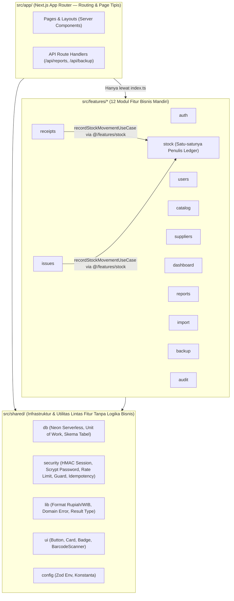
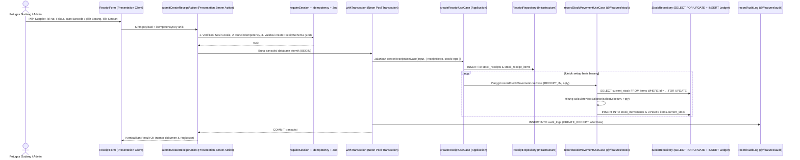

# Arsitektur Sistem Pergudangan Barang KDKMP Lubuk Ogung

Dokumen ini menjelaskan arsitektur modular berbasis fitur (*Feature-Driven 4-Layer Architecture*) yang diterapkan pada **Sistem Pergudangan Barang KDKMP Lubuk Ogung (Tahap 1 — MVP)**.

---

## 1. Diagram Modul dan Arah Dependensi

### Aturan Arah Impor Lintas Lapisan
1. **`app -> features -> shared`**:
   - `src/shared/*` **DILARANG** mengimpor `src/features/*` atau `src/app/*`.
   - `src/features/*` **DILARANG** mengimpor `src/app/*`.
2. **Di Dalam Setiap Fitur (`4 Lapisan`)**:
   - `presentation -> application -> domain`
   - `infrastructure -> domain`
   - `domain` adalah lapisan murni (**pure TypeScript**): tidak boleh mengimpor `application`, `infrastructure`, `presentation`, `drizzle-orm`, `react`, maupun `next/*`.
3. **Isolasi Antar-Fitur (Public API Gatekeeper)**:
   - Fitur A hanya boleh mengimpor Fitur B melalui pintu publik `@/features/B` (`src/features/B/index.ts`).
   - Impor langsung ke folder internal fitur lain (`@/features/B/domain/*`, `@/features/B/infrastructure/*`, dll.) diblokir oleh ESLint (`no-restricted-imports`) dan `scripts/check-arch.mjs`.
4. **Aturan Tunggal Penulis Ledger (`stock_movements`)**:
   - Hanya fitur `src/features/stock` yang boleh menyisipkan baris ke tabel `stock_movements`.
   - Fitur `receipts`, `issues`, dan penyesuaian stok memanggil `recordStockMovementUseCase` dari `@/features/stock` di dalam transaksi database (`withTransaction`) yang sama.

---

## 2. Tanggung Jawab Tiap Fitur (`src/features/`)

| Fitur | Tanggung Jawab Bisnis Utama | Tabel yang Dikelola |
| :--- | :--- | :--- |
| **`auth`** | Autentikasi username + password, rate limiting login, sesi JWT HMAC `httpOnly`, wajib ganti password saat login pertama. | Membaca/memperbarui `users` |
| **`users`** | Kelola akun Petugas Gudang & Admin (tambah akun, aktif/nonaktifkan, reset password sementara). Khusus Admin. | `users` |
| **`catalog`** | Master Barang (SKU, barcode, kategori, satuan dasar, konversi satuan opsional, harga beli/jual, stok minimum). | `categories`, `units`, `items` |
| **`suppliers`** | Master Supplier pemasok barang ke koperasi (kode, nama, kontak, telepon, alamat). | `suppliers` |
| **`receipts`** | Pencatatan dokumen Barang Masuk dari supplier dan pembatalan (*Void*) dokumen dengan jurnal pembalik. | `stock_receipts`, `stock_receipt_items` |
| **`issues`** | Pencatatan dokumen Barang Keluar (Anggota, Umum, Internal) dan *Void* dokumen dengan jurnal pembalik. | `stock_issues`, `stock_issue_items` |
| **`stock`** | **Inti Ledger**: mutasi stok (`stock_movements`), penguncian baris (`FOR UPDATE`), kartu stok berjalan, dan penyesuaian stok manual (* rusak/hilang/koreksi*). | `stock_movements`, `stock_adjustments` |
| **`dashboard`** | Ringkasan KPI gudang (total SKU, stok menipis, transaksi hari ini, 10 mutasi terakhir, grafik 30 hari). | Agregasi baca `items` & `stock_movements` |
| **`reports`** | Pembuatan laporan resmi KDKMP Lubuk Ogung ke format **Excel (.xlsx)** dan **PDF (.pdf)** lengkap dengan blok tanda tangan. | Agregasi baca lintas tabel |
| **`import`** | Impor katalog barang massal dari CSV/Excel dengan pratinjau validasi dan laporan daftar error per baris. | Upsert ke `categories`, `units`, `items` |
| **`backup`** | Ekspor cadangan seluruh tabel database ke berkas bundel JSON/SQL untuk Admin. | Baca seluruh tabel gudang |
| **`audit`** | Pencatatan jejak audit permanen (*append-only*: siapa, aksi apa, kapan, nilai sebelum & sesudah). | `audit_logs` |

---

## 3. Contoh Alur End-to-End: "Catat Barang Masuk" dari Form sampai Ledger

Berikut adalah urutan eksekusi ketika Petugas Gudang atau Admin mencatat Barang Masuk:

---

## 4. Checklist Cara Menambah Fitur Baru

Saat menambahkan fitur bisnis baru (misal: `stock-opname` pada Tahap 2), ikuti langkah-langkah berikut:

1. **Buat Struktur 4 Lapisan di `src/features/<nama-fitur>/`**:
   - `domain/`: Buat fungsi murni perhitungan dan aturan bisnis + interface port repository. Tanpa impor DB/React/Next.
   - `application/`: Buat satu file per use-case yang menerima repository melalui parameter (`deps`).
   - `infrastructure/`: Implementasikan repository dengan Drizzle ORM.
   - `presentation/`: Buat Server Actions tipis (validasi Zod -> cek peran -> `withTransaction` -> use-case) dan komponen UI mobile-first.
   - `schemas.ts`: Definisikan skema validasi input dengan Zod.
   - `index.ts`: Ekspor hanya API publik yang diperlukan oleh `src/app/` atau fitur lain.
   - `README.md`: Dokumentasikan tujuan fitur, API publik, tabel yang dimiliki, dan aturan bisnis utama.
   - `__tests__/`: Tulis unit test untuk domain dan use-case.
2. **Patuhi Batas Baris & Kompleksitas**:
   - Maksimal **200 baris kode aktif** per file dan **40 baris kode aktif** per fungsi.
3. **Gunakan API Publik `@/features/stock` untuk Mutasi Stok**:
   - Jangan pernah menulis langsung ke `stock_movements` dari luar fitur `stock`.
4. **Jalankan Verifikasi Arsitektur & Kualitas**:
   - Jalankan `npm run check:arch`, `npm run lint`, `npm run typecheck`, dan `npm test` sebelum membuat Pull Request.
